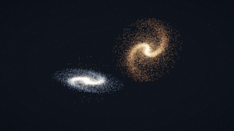
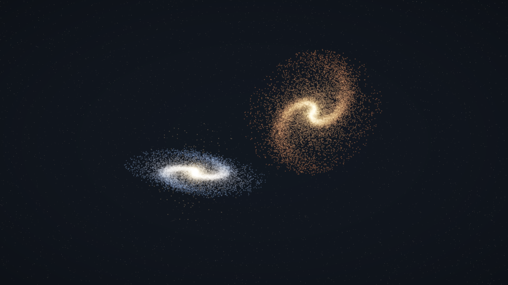
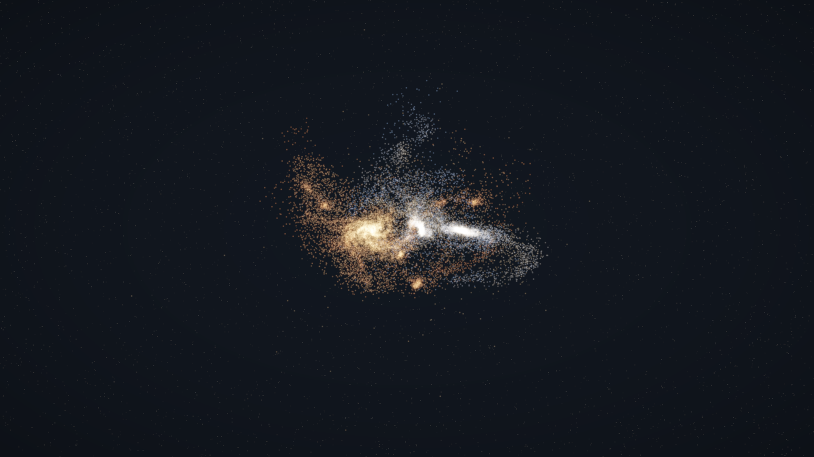
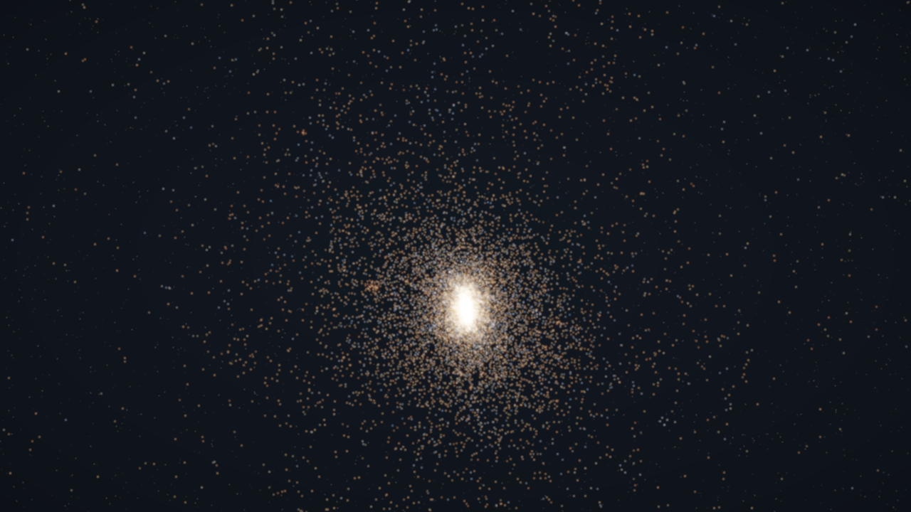
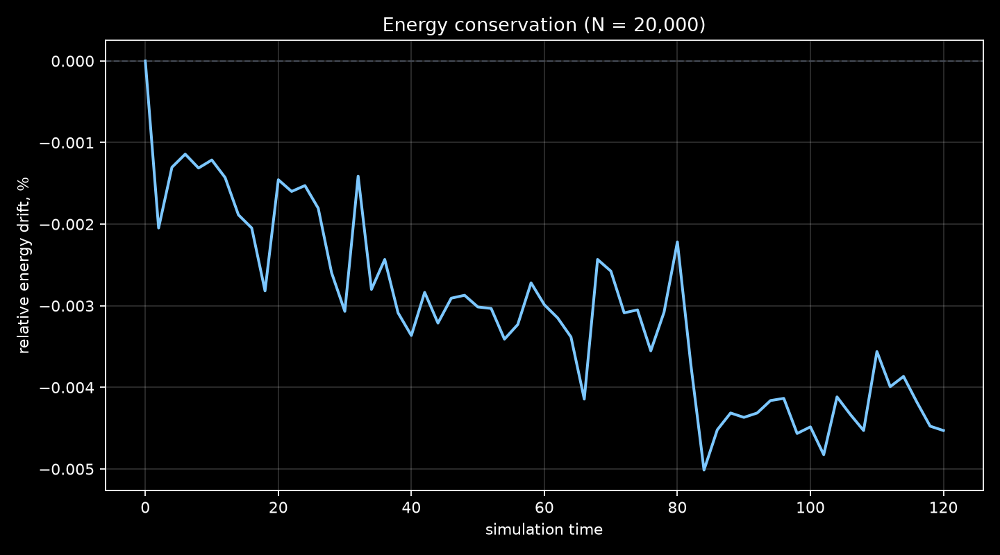

# Galaxy Merger — GPU N-body

Интерактивная симуляция столкновения двух спиральных галактик на Python + Taichi.
Гравитация считается прямым суммированием на GPU, интегрирование — leapfrog,
рендер — аддитивные частицы со свечением и bloom.



[Полное видео (MP4, ~19 МБ)](media/galaxy_merger_final.mp4) · [Начальное состояние](media/hero.png) · [Столкновение](media/collision.png) · [Остаток](media/remnant.png)

**Стек:** Python 3.10+, Taichi 1.7, NumPy, Matplotlib, Pillow, imageio/ffmpeg.
**Железо для цифр ниже:** NVIDIA GTX 1660 SUPER 6 GB, CUDA, Windows.

## Что внутри

- Две модельные галактики: экспоненциальный диск со спиральными рукавами,
  центральный Plummer-балдж и круговые скорости по вложенной массе.
- Прямое O(N²) суммирование гравитации с мягкой силой (softening) в ядрах Taichi.
- Симплектический интегратор leapfrog (kick-drift-kick) — энергия не «улетает».
- 3D-камера, аддитивный HDR-рендер, bloom, tone mapping и статическое звёздное поле.
- Headless-режим: превью, серии кадров, графики энергии, бенчмарки.
- Генерация MP4 без сохранения тысяч PNG на диск.
- Тесты физики: сила против NumPy-эталона, сохранение энергии и импульса.

## Кадры

| Начальное состояние | Столкновение | Остаток |
|---|---|---|
|  |  |  |

Диагностика энергии для прогона `N = 20 000`, `t = 120`:



## Быстрый старт

```powershell
python -m venv .venv
.\.venv\Scripts\activate
python -m pip install -e ".[video]"
galaxy run
```

Linux/macOS:

```bash
python -m venv .venv
source .venv/bin/activate
pip install -e ".[video]"
galaxy run
```

Если команда `galaxy` недоступна, используйте `python -m galaxy run`.

### Управление

| Ввод | Действие |
|---|---|
| `Space` | пауза / продолжить |
| `R` или `Enter` | пересоздать начальные условия |
| стрелки | вращать камеру |
| зажать ЛКМ и вести мышью | вращать камеру |
| `+` / `-` | скорость симуляции (шагов на кадр) |
| `Esc` | выход |

### Headless

```powershell
galaxy headless --n 20000 --steps 1200 `
  --out media/preview.png `
  --frames-dir media/frames --frame-every 100 `
  --energy-csv media/energy.csv
```

Сохраняет финальный кадр, при необходимости серию кадров и CSV с полной энергией.
Рядом с CSV появляется график относительного дрейфа энергии.

### Видео

```powershell
python scripts/render_video.py `
  --n 30000 --speed 0.35 --steps 5000 --frame-every 4 `
  --scale 40 --zoom-out 0.2 `
  --out media/galaxy_merger_final.mp4
```

Скрипт запускает симуляцию, рендерит кадры и сразу кодирует их в H.264 через
`imageio-ffmpeg`, не создавая промежуточные PNG.

### Бенчмарк

```powershell
galaxy bench --sizes 5000 20000 50000
```

## Физика

Единицы: `G = 1`, масштаб диска `h = 1`, масса диска `1`, масса балджа `0.22`.
Мягкая гравитация:

$$
\mathbf{a}_i = \sum_{j \ne i} G m_j
\frac{\mathbf{r}_j - \mathbf{r}_i}
{\left(|\mathbf{r}_j - \mathbf{r}_i|^2 + \epsilon^2\right)^{3/2}},
\qquad \epsilon = 0.15.
$$

Leapfrog (KDK):

$$
\mathbf{v} \leftarrow \mathbf{v} + \frac{\Delta t}{2}\mathbf{a}, \quad
\mathbf{x} \leftarrow \mathbf{x} + \Delta t\,\mathbf{v}, \quad
\text{пересчёт } \mathbf{a}, \quad
\mathbf{v} \leftarrow \mathbf{v} + \frac{\Delta t}{2}\mathbf{a}.
$$

Начальные условия:

- радиус диска сэмплируется из $p(r) \propto r e^{-r/h}$ (Gamma(2)),
- часть частиц ставится в два логарифмических спиральных рукава,
- балдж — изотропная Plummer-сфера,
- азимутальная скорость — $v_c(r)=\sqrt{G M(<r)/r}$ по массе диска и балджа,
- две галактики с разными наклонами и направлениями вращения запускаются
  по связанной орбите с прицельным параметром.

Шаг по умолчанию `dt = 0.02`, softening `0.15`. На тестовом прогоне
`N = 20 000`, `t = 120` относительный дрейф полной энергии меньше **0.005%**.

## Производительность

Прямое суммирование, только шаги симуляции, без рендера (после `ti.sync()`):

| N | шагов/с | млрд парных взаимодействий/с |
|---:|---:|---:|
| 5 000 | 1 125 | 28.1 |
| 20 000 | 211 | 84.5 |
| 50 000 | 46.6 | 116.5 |

Это честный потолок O(N²) на GTX 1660 SUPER. Для 1 млн частиц нужен
Barnes-Hut или particle-mesh — это следующий шаг развития проекта.

## Тесты

```powershell
pytest
```

Проверяется:

- ускорение совпадает с NumPy-эталоном (rtol 3e-3),
- относительный дрейф энергии за 100 шагов меньше 1%,
- суммарный импульс сохраняется,
- начальные условия конечны, центр масс и импульс близки к нулю.

## Структура

```text
src/galaxy/
  config.py             параметры симуляции
  initial_conditions.py генерация галактик
  core.py               Taichi-ядра, интегратор, энергия
  render.py             камера, splatting, bloom, звёздное поле
  app.py                интерактивное окно
  headless.py           превью, кадры, графики, бенчмарк
  cli.py                команды galaxy run/headless/bench
scripts/
  render_video.py       симуляция → MP4
tests/
  test_physics.py
media/
  hero.png              начальное состояние
  collision.png         столкновение
  remnant.png           остаток
  energy.png            дрейф энергии
  merger_preview.gif    превью для README
```

## Что показывает проект

- GPU-ядра на Taichi и работа с памятью без CUDA-обвязки.
- Численные методы: softened gravity, symplectic integrator, диагностика энергии.
- Измерение производительности и понимание асимптотики O(N²).
- Рендер с нуля: проекция, HDR-буфер, bloom, tone mapping.
- Инженерная упаковка: CLI, пакет, тесты, воспроизводимые эксперименты, видео.

## Ограничения и планы

- **O(N²)** — основной предел. Следующий шаг: Barnes-Hut (Morton-коды, обход
  октодерева) или particle-mesh с FFT для 10⁶ частиц.
- Нет тёмного гало, звёздообразования и обратной связи; кривая вращения на
  больших радиусах падает, а не остаётся плоской.
- Физические единицы условные: важна динамика, а не абсолютные мегапарсеки.
- Интерактивное окно использует legacy `ti.GUI`: на Windows с кириллицей в пути
  новый Vulkan-UI не находит свои шейдеры. Если перенести проект в путь без
  кириллицы, можно перейти на `ti.ui.Window`.
- Видео весит ~19 МБ и лежит в репозитории; для более длинных версий лучше
  использовать GitHub Releases или YouTube.

## Лицензия

MIT. См. [LICENSE](LICENSE).
